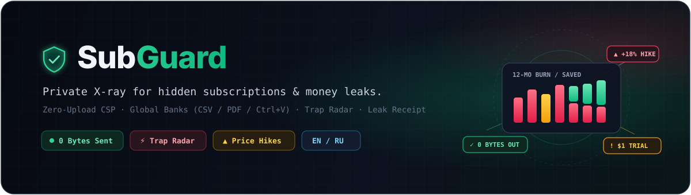
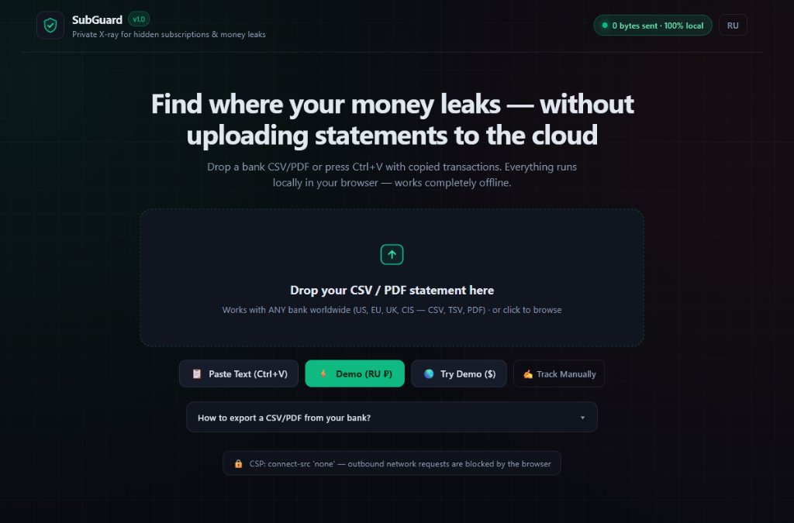
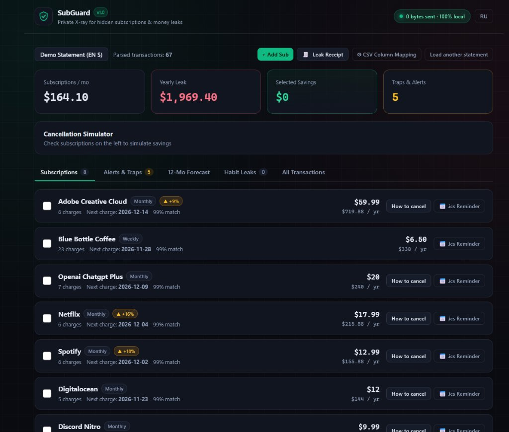
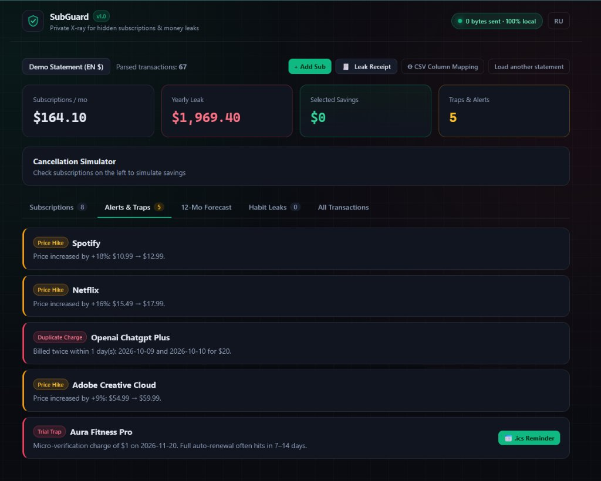
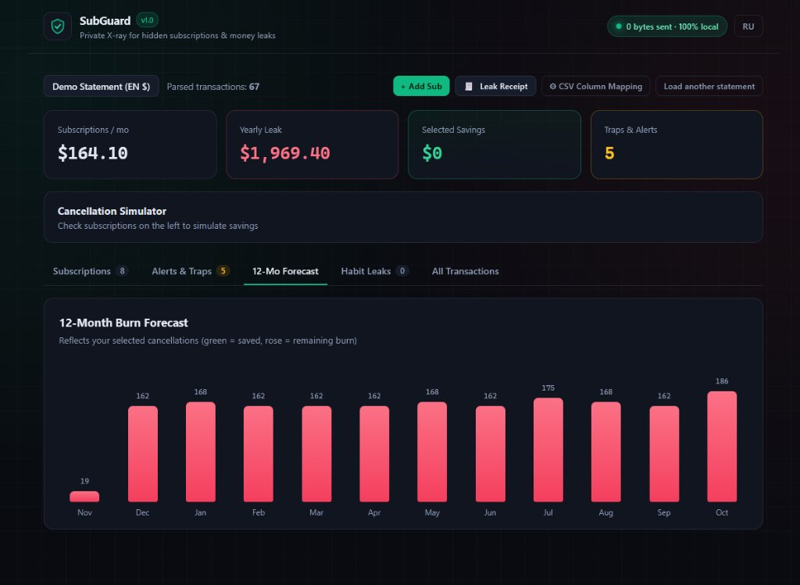

<p align="center">
  
</p>

<p align="center">
  <a href="https://goblin-inc.github.io/SubGuard/"></a>
  
  
  
  <a href="LICENSE"></a>
</p>

<p align="center">
  <b><a href="https://goblin-inc.github.io/SubGuard/">🚀 Try Live Demo</a></b> ·
  <a href="README_Ru.md">🇷🇺 Русская версия</a> ·
  <a href="#-screenshots">Screenshots</a> ·
  <a href="#-quick-start">Quick Start</a>
</p>

---

**SubGuard** is a **100% client-side, zero-upload** subscription & money-leak X-ray that runs completely offline inside your browser.

Drop a bank statement (`CSV` / `PDF`), paste copied transactions via `Ctrl + V`, or track subscriptions manually — SubGuard detects recurring billing cycles, stealth price hikes, duplicate charges, trial traps, and habit leaks **without sending a single byte over the network**.

> **Verifiable Privacy:** SubGuard ships with a strict `Content-Security-Policy: connect-src 'none'`. Open DevTools → Network to confirm **0 outbound requests**.

---

## 🖼️ Screenshots

### Landing & Zero-Upload Dropzone
<p align="center">
  
</p>

### Subscriptions & Live Cancellation Simulator
<p align="center">
  
</p>

### Traps & Alerts Radar (Price Hikes, Duplicates, $1 Trial Traps)
<p align="center">
  
</p>

### 12-Month Burn & Savings Forecast
<p align="center">
  
</p>

---

## ✨ Key Features

- **🔒 Provable Zero-Upload & Offline PWA** — runs locally in vanilla ES modules with zero third-party CDNs or tracking; works with Wi-Fi turned off.
- **🌍 Global Multi-Bank Client Parser (`CSV` / `PDF` / `Ctrl+V`)** — works with US, EU, UK & CIS banks (auto-detects `MM/DD/YYYY` & `DD/MM/YYYY`, separate `Debit/Credit` columns, UTF-8 & Windows-1251 encodings, and 12 global currencies `USD / EUR / GBP / RUB / CAD / AUD / JPY / CHF / PLN / TRY / UAH / KZT`).
- **🔁 Cycle & Merchant Normalization Engine** — strips bank noise (`POS`, card digits, city names) and identifies weekly, biweekly, monthly, quarterly, and yearly subscriptions.
- **🚨 Anomaly & Trap Radar:**
  - **Stealth Price Hikes** (`+18%` creep alerts comparing first vs latest charge)
  - **Duplicate Charges** (double billing within ≤3 days)
  - **Trial Traps** (micro-verification charges `≤ $2 / 15 ₽` with 1-click `.ics` calendar reminder)
- **🧮 Live Cancellation Simulator & 12-Month Forecast** — check subscriptions to drop and see yearly savings, tangible equivalents, and a 12-month burn chart update live.
- **📖 Built-in Cancel Playbook** — local JSON database of direct cancellation links and dark-pattern warnings for popular services (Adobe, Spotify, Netflix, Amazon Prime, ChatGPT, Yandex Plus, Apple/iCloud, Discord, Hulu, Disney+, etc.).
- **🧾 Shareable Leak Receipt (`PNG` / `SVG`)** — export a clean summary card with an optional **Hide Exact Amounts (`••••`)** privacy toggle.
- **✍️ Manual Mode (`localStorage`)** — add & persist subscriptions manually even without a bank statement.

---

## 🚀 Quick Start

### Option 1 — Live Web App (Zero Install)
Open **[goblin-inc.github.io/SubGuard](https://goblin-inc.github.io/SubGuard/)** and click **Try Demo ($)** or **Demo (RU ₽)** to explore in 5 seconds.

### Option 2 — Run Locally (Zero Build Step)
```bash
git clone https://github.com/Goblin-Inc/SubGuard.git
cd SubGuard
python -m http.server 8080
# Open http://localhost:8080
```

---

## 📄 License
MIT © [Goblin-Inc](https://github.com/Goblin-Inc)
